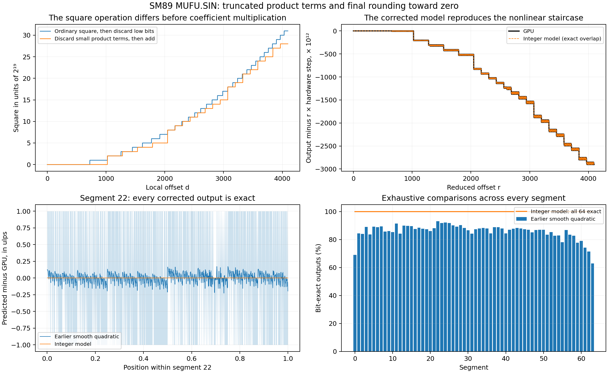

# Bit-exact reduced-angle SM89 sine model

2026-10-19, RTX 4070 Laptop GPU. The follow-up to the smooth polynomial fits
recovers an integer model that matches **every output at all 8,388,608 reduced
grid positions**. All 64 segments are exact throughout. The quarter-turn
endpoint also matches after the separately established quadrant reduction.



The key is to discard small multiplication terms **before adding them**, and to
convert the final result to float32 **toward zero**. An ordinary square followed
by truncation is different: individually discarded terms can otherwise add up
to a carry into the retained region.

## Model

Start with the reduced offset `r`, an integer in `[0, 2^23)`. Argument reduction
and the final sign are described in the adjacent reduction investigation.

```text
segment = r >> 17
d = r & 0x1ffff
```

Write `d` as bits `d_i`. The modified square retains each diagonal term `2^(2i)`
only when `2i >= 19`, and each combined symmetric cross term `2^(i+j+1)` only
when `i+j+1 >= 19`. Sum the retained terms in units of `2^19` to obtain `I`.
This is not `floor(d*d / 2^19)`: that would allow carries from discarded terms.

An equivalent fast integer implementation is:

```python
H = d >> 10
L = d & 1023
I = 2 * H * H
for k in range(7):
    I += ((H >> k) & 1) * (L >> (8 - k))
```

Select the three integer coefficients `[a0, a1, a2]` for that segment from
`quantized-model.json`. Calculate:

```text
N = (a0 << 12) + a1*d + a2*I
result = float32_toward_zero(N * 2^-37)
```

All arithmetic before the float32 conversion is integer arithmetic. `N` fits in
38 bits over this domain. `sin_quantization.fixed_to_float32` performs the final
conversion with integer shifts, discarding excess significand bits. The implied
coefficient scales are `a0/2^25`, `a1/2^20` and `a2/2^22`; the modified square
has 15 fractional bits when interpreted in normalized segment coordinates.
These scales describe a successful behavioral model, not established physical
register widths or coefficient-storage formats inside the chip.

### First segment

The coefficient triple is `[0, 25737, -14]`, so:

```text
N = 25737*d - 14*I
```

For every `d < 1024`, all square terms are discarded and `I = 0`. This explains
why multiplying by the measured slope, with final truncation toward zero,
matches the first 1,024 outputs. At `d=1024`, `I=2`; at `d=1280`, `I=3`.
Those changes produce the observed staircase in the nonlinear correction.

At the first nonzero offset (`d=1`), the model gives `25737/2^37`, exactly
`1.8726132111623883e-7` (`0x34491200`). Ordinary sine at that reduced angle is
`1.8725351414619535e-7`. The model therefore reproduces the small-angle gain
exactly, rather than approximating it through a fitted smooth coefficient.

## Recovery and validation

The arithmetic was discovered retrospectively from the recorded outputs of
segment 0: final nearest rounding failed at particular products while truncation
matched; the staircase then identified the retained square terms. It was fixed
before applying the same arithmetic to the other segments.

For each segment, fit coefficients on 8,192 random positions (seed 22). A
toward-zero output describes the interval `[output, next_float(output))`; fitting
the interval midpoints avoids the bias from treating the rounded output as the
exact internal value. Snap the resulting coefficients to the integer grids
above, then check every position. The remaining 122,880 positions per segment
are disjoint coefficient holdouts. These are retrospective checks on captured
hardware data, not a new blinded hardware experiment.

| Check | Inputs | Mismatches |
| --- | ---: | ---: |
| Complete reduced domain, 64 segments | 8,388,608 | 0 |
| Coefficient-fitting positions | 524,288 | 0 |
| Remaining coefficient holdouts | 7,864,320 | 0 |
| Quarter-turn endpoint after reduction | 1 | 0 |
| Earlier shared-harness SIN/COS observations | 84,488 | 0 |
| Original saved SIN samples | 1,462 | 0 |
| Original saved COS samples | 1,462 | 0 |

The sample comparisons combine the integer evaluator with the reduction model,
including signs, zeros and canonical NaNs. Independent scalar enumeration of
square terms checks the fast high/low implementation; scalar integer bit-length
conversion checks the vector float32 conversion.

Changing either arithmetic detail loses exactness with the same coefficients:

| Arithmetic change | Exact over complete reduced domain |
| --- | ---: |
| Recovered partial-product square + final truncation | 100% |
| Ordinary square, then discard low bits + final truncation | 77.75% |
| Recovered square + final nearest-even rounding | 50.04% |

The normalized square rule was also fitted at 32 and 128 segments, keeping the
same accumulator and constant/quadratic coefficient scales and adapting the
linear scale to segment width:

| Segments | Exact | Worst ulp distance |
| --- | ---: | ---: |
| 32 | 6.51% | 1,976 |
| 64 | 100% | 0 |
| 128 | 45.70% | 129 |

These are comparisons within this arithmetic family. They do not rule out
other parameterizations using 32/128 entries or establish the physical table
layout. A 64-entry integer table and this common arithmetic suffice to reproduce
the complete captured reduced domain.

The earlier smooth fits and their plots remain as baselines. Their lack of an
exact segment concerned ordinary quadratic evaluation, not the corrected
truncated-product model.

## Reproduction and limits

From the repository root, using NumPy:

```sh
PYTHONPATH=. python3 research/mufu/sin_quantization.py
```

This writes the recovered coefficients (`quantized-model.json`) and exhaustive
results (`quantization.json`). It verifies the existing captured-data checksum
and requires no GPU. Re-run `sin_structure.py` as documented in the main README
to regenerate `quantization.png` and its SVG version.

All measured evaluator offsets are covered, but the outer reduction rule has
not been exhaustively checked across every binary32 input. The resulting
SIN/COS model is exact on the saved full-input observations; other architectures,
modifiers and half-precision forms are untested. This remains research code,
with no runtime handler or new regression verification credit. Matching the
data establishes a behavioral implementation, not a unique physical circuit.
