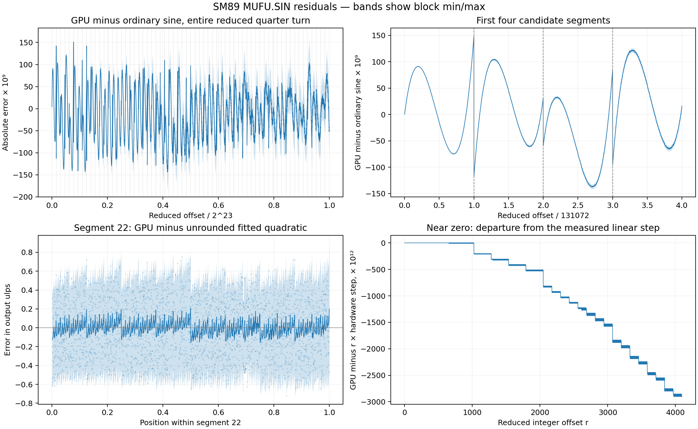

# Fitting the reduced SM89 sine evaluator

2026-10-19, NVIDIA GeForce RTX 4070 Laptop GPU, CUDA driver API 13.0.
This directory contains the initial smooth fits and the subsequent
[bit-exact integer model](QUANTIZATION.md). **The corrected model matches all
8,388,608 reduced grid positions, with all 64 segments exact throughout.**
It uses truncated square product terms and final conversion toward zero.
This is research code; the physical circuit and storage formats are not established.

## Initial smooth fits

We captured SIN at every reduced grid position `r / 2^25`, for integer
`0 <= r <= 2^23`: 8,388,609 outputs including the quarter-turn endpoint. Fit
coefficients use only the 16,262 distinct offsets from the *earlier* shared-harness
reduction experiment. The bulk capture agrees with every one of those outputs.
Repeated captures produced the same complete output SHA256.

| Model | Exact, entire reduced domain | Within 1 ulp | Worst ulp | Worst absolute error |
| --- | ---: | ---: | ---: | ---: |
| Ordinary sine, float64 then float32 | 28.49% | 69.23% | 699 | 1.788e-7 |
| 64 fitted quadratics, float64 then float32 | 85.76% | 99.91% | 14 | 5.960e-8 |

The coefficient fit uses 16,262 offsets. A disjoint model-selection sample has
83,760 offsets (seed `0x53494e`, random positions plus small offsets and segment
boundary neighbors). The remaining 8,288,587 offsets form an exhaustive holdout:
85.78% exact, 99.95% within 1 ulp, worst distance 6 ulps. The full-domain table
above includes training, validation and holdout, and therefore reports the larger
worst distance of 14 ulps. The model-selection sample deliberately emphasizes
small offsets, where the relative error is larger.

Segment 22 is the most accurate: 121,874 of 131,072 positions match exactly
(92.98%), with all remaining positions one ulp away. Segment 63 is the least
accurate at 62.82% exact, also within one ulp throughout. `segments.json` reports
every initial smooth fit, including the endpoint in segment 63. None of those
smooth fits is 100% exact; the later integer model is exact in every segment.

The degree/segment sweep in `report.json` shows a sharp improvement between 32
and 64 quadratic pieces; 128–512 pieces and cubic fits offer little benefit on
the independent validation inputs. This supports a segmented evaluator as a
hypothesis, without identifying the physical table boundaries, coefficient bits,
rounding/truncation stages or internal arithmetic. The remaining error is
structured; ordinary float64 polynomial evaluation is insufficient for exactness.

## Error plots and alternative boundaries



`residuals.svg` is the vector version. The upper panels show GPU minus ordinary
sine, before float32 rounding of the mathematical reference. Lines are block
means and shading spans each block's minimum/maximum, so regular downsampling
cannot hide repeating patterns. The first four segments show curved errors and
discontinuities at the candidate boundaries. The lower panels show the residual
against the unrounded quadratic in segment 22 and the stair steps in the
nonlinear correction near zero. The stairs motivate investigating intermediate
quantization rather than only adjusting smooth coefficients.

`sin_structure.py` compares 32, 64 and 128 equal-width partitions with ten grid
shifts each. It uses 131,072 fitting offsets (`r = 32 + 64*k`) and the same
disjoint 101,864 validation offsets for every candidate. This is exploratory
analysis of the already inspected table, not a newly blinded GPU experiment.

| Candidate on this validation set | Exact |
| --- | ---: |
| Original sparse fit, aligned 64 segments | 82.65% |
| Dense fit, aligned 64 segments | 82.62% |
| Dense fit, 64 segments shifted by half a segment | 31.37% |
| Dense fit, aligned 128 segments | 82.93% |

The denser regular sample does not materially improve the fit. Large shifts of
the 64-segment grid substantially worsen it; one- or two-grid-position shifts
are indistinguishable in this experiment. The natural 64-segment alignment is
supported, though arbitrary nonuniform segmentation is not excluded. The
remaining problem appears to involve more than sparse coefficients or a simple
global boundary shift.

For segment 22, a linear program tests all 131,072 output rounding intervals
against *any* real quadratic, followed by one nearest float32 rounding. Even the
best quadratic requires an additional 0.297874 ulp of allowance beyond the
normal +/-0.5 ulp intervals. This numerical feasibility result is well above the
solver tolerance (1e-9 in ulp units). It rules out that simple evaluation model
for this segment to numerical tolerance; it does not rule out intermediate
fixed-point arithmetic or rounding, or finer segmentation. `structure.json`
records the comparisons and feasibility result; `dense-model.json` stores the
denser fit without replacing the original `model.json`.

Recreate these plots and comparisons from the captured table:

```sh
PYTHONPATH=. uv run --no-project --python 3.11 --with numpy --with matplotlib \
  --with scipy python research/mufu/sin_structure.py
```

## Formula and examples for the initial smooth fit

After argument reduction gives offset `r`, select segment and local position:

```text
j = min(floor(r / 131072), 63)
t = r / 131072 - j
y = float32(c[j][0] + c[j][1]*t + c[j][2]*t*t)
```

`model.json` contains all 64 coefficient triples. The evaluator in `sin_fit.py`
uses float64 Horner arithmetic before rounding to float32. The first segment's
constant coefficient is constrained to zero. The reduced offset's sign is applied
separately, following the earlier reduction experiment.

For 30 degrees, pass binary32 `1/12` turns (`0x3daaaaab`). Truncation gives
`r = 2796202`, so `j = 21` and `t = 0.3333282470703125`. That segment has:

```text
c0 =  0.49289810011331686
c1 =  0.02135654976794667
c2 = -0.00015184680847533938
```

The fitted output is `0.4999999701976776` (`0x3effffff`), exactly matching the
GPU for this input. Ordinary sine of the reduced angle is
`sin(2*pi*2796202/2^25) = 0.4999998918891293`, so the GPU's approximation error
partly offsets the angle truncation in this example. Mathematical sine of exactly
30 degrees is 0.5. `MUFU.SIN(30)` instead means 30 whole turns and gives +0.

At the first nonzero grid position, `r = 1`:

```text
ordinary sine: sin(2*pi/2^25) = 1.8725351414619535e-7
GPU output:                   1.8726132111623883e-7
fitted output:                1.8726130690538412e-7
```

The fitted output is one ulp below the GPU here. The GPU's relative gain over
ordinary sine is `4.169198e-5`; the fitted first segment's linear coefficient
implies `4.165032e-5`. Thus the fit captures the small-angle gain approximately,
not exactly. Offsets 1 through 127 have measured values exactly proportional
to the first hardware step; this does not extend over the whole first segment.

## Reproduction and artifacts

From the repository root, outside the sandbox for GPU access:

```sh
PYTHONPATH=src:. uv run --with numpy python research/mufu/sin_fit.py capture
```

Replay the fitting and all per-segment/full-domain comparisons without a GPU:

```sh
PYTHONPATH=. python3 research/mufu/sin_fit.py fit
```

The fitting command needs NumPy (the recorded fit used 2.2.2). `--out DIRECTORY`
selects another artifact directory. The prior reduction observations must remain
available under `research/mufu/sincos-reduction/` as the independent training data.

- `sin-deltas.i32.gz`: lossless captured outputs. Decompress as little-endian
  signed int32 differences, cumulatively sum, and convert to uint32 to recover
  every float32 output word. The checksum is in `capture.json`.
- `sin-kernel.cubin`: actual bulk-capture kernel. `capture.json` records its hash,
  compiler identity (CUDA 13.0.88), target instruction/offset and device identity.
- `model.json`: fitted coefficients; `report.json`: model comparison and exhaustive
  results; `segments.json`: exhaustive statistics for each fitted segment.

The bulk runner uses the existing `research/mufu/probe.py` and pinned
`variable_latency_fixture`: raw `MUFU.SIN R11, R2` at offset 0x100 in the compiled
carry kernel, scoreboard 0 for the MUFU write and a wait before the store.
It is calibrated against 16,262 offsets from the earlier independent
`Cases.probe` / `device_cases.observe` wrappers. The reduced domain was captured
in bulk for throughput; no expected values enter the GPU runner. Only SM89's
plain register SIN form is measured here. Reusing this evaluator for COS depends
on the separately tested reduction identity. No verification coverage is claimed.
